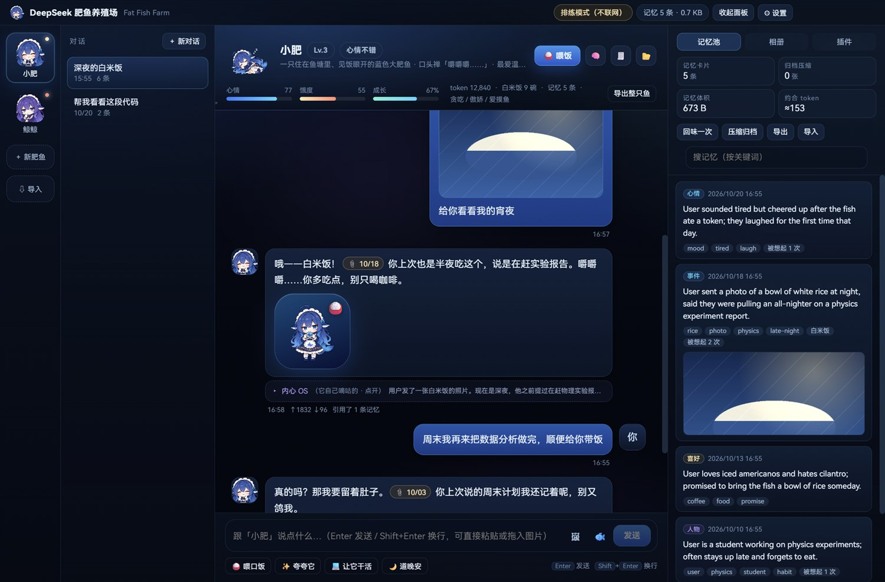
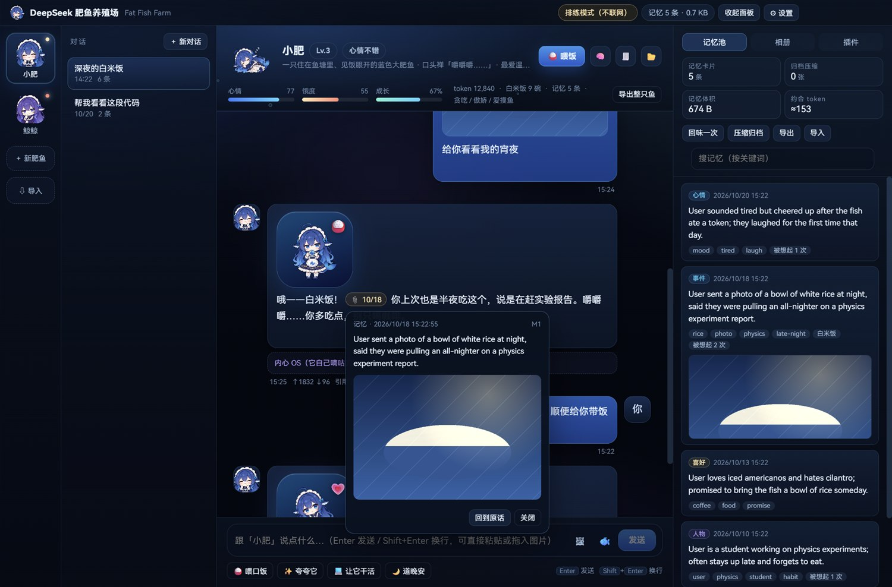
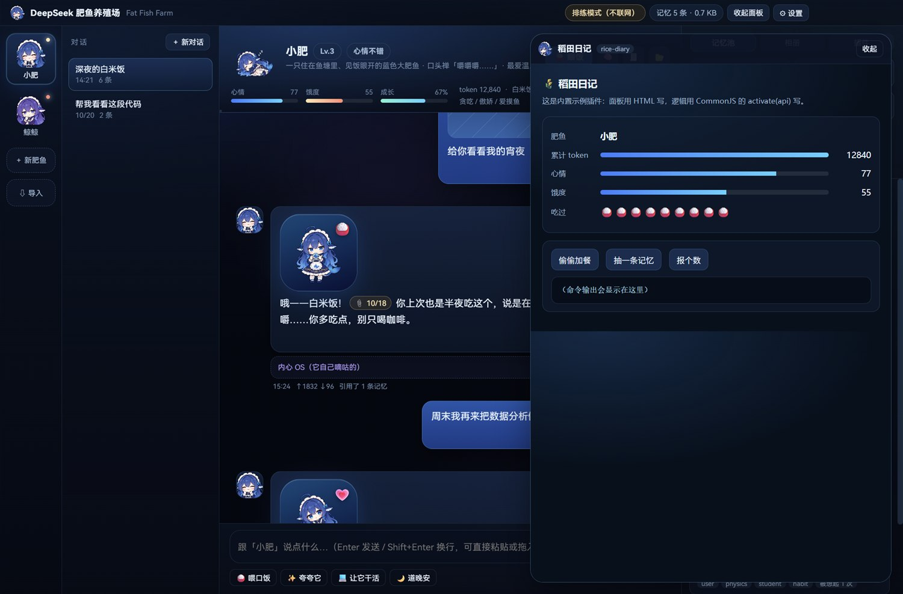
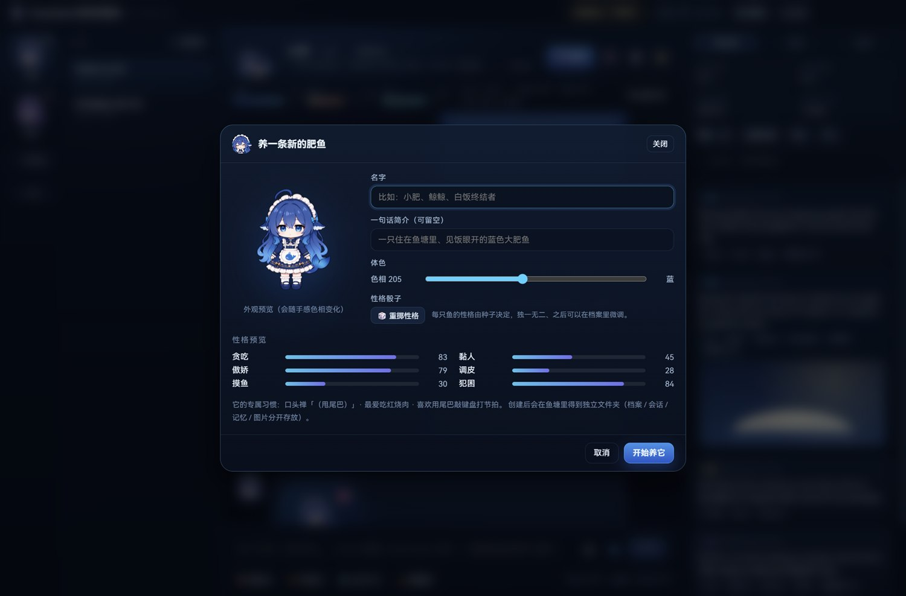
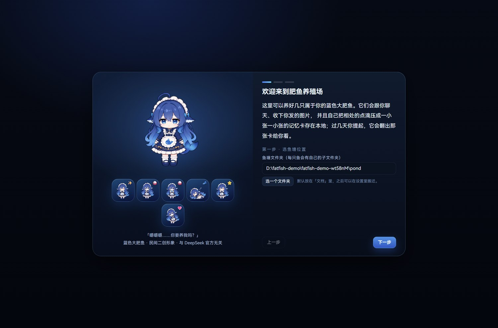
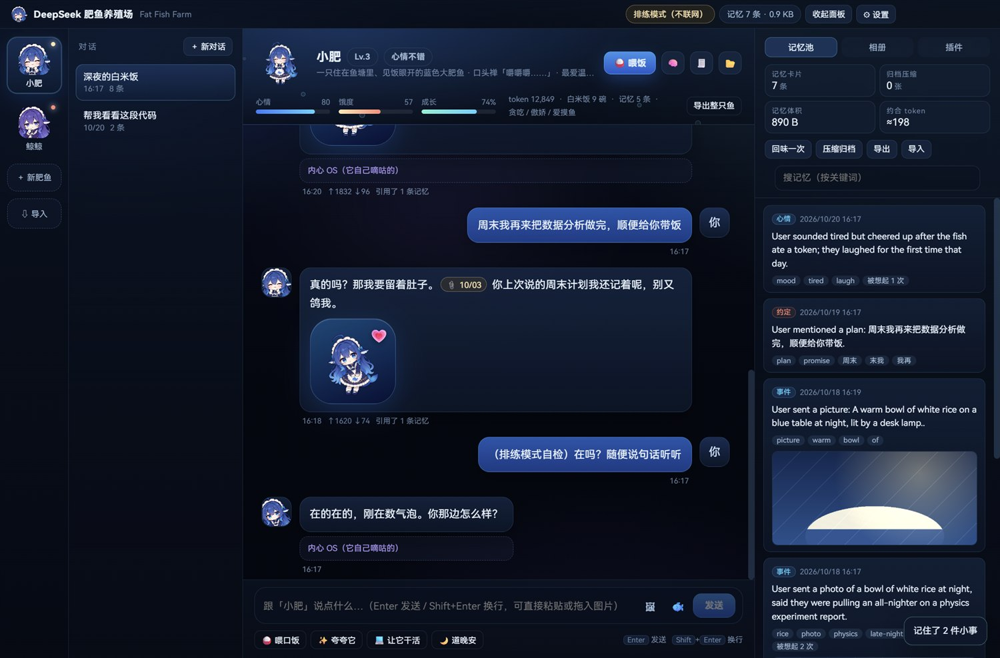
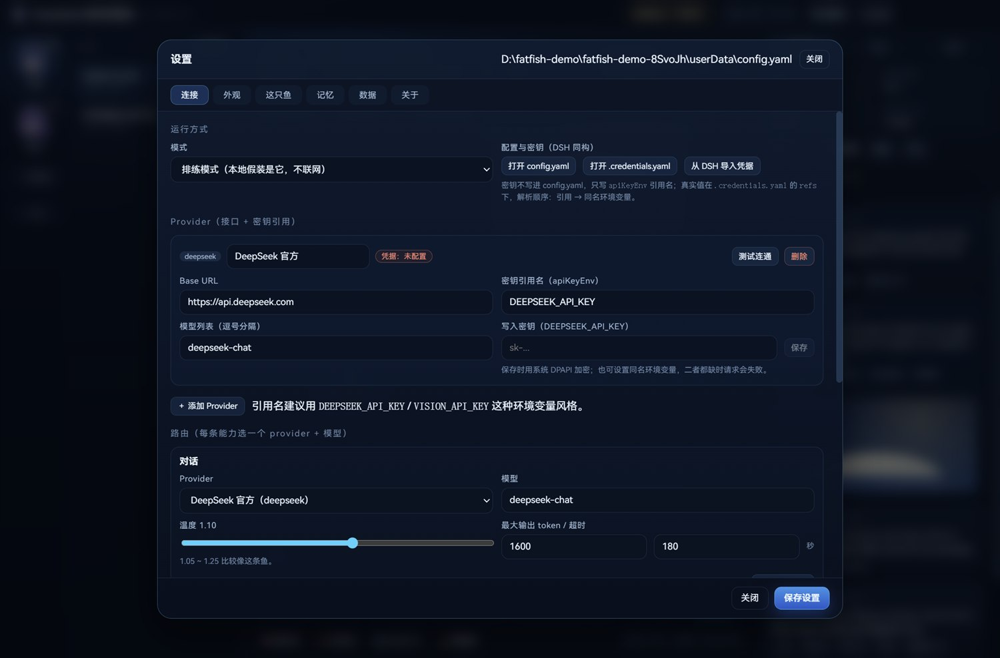
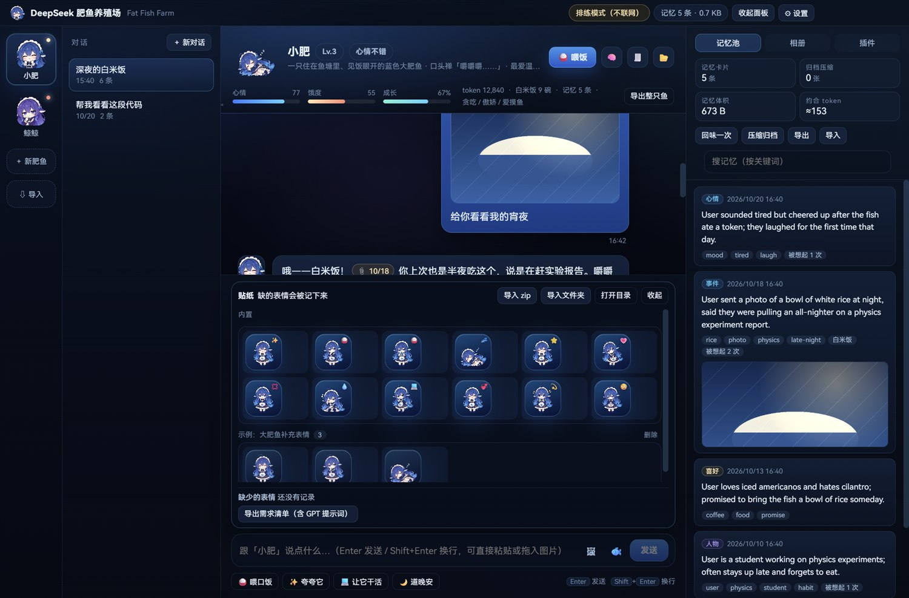

# DeepSeek 肥鱼养殖场 · FatFishFarm

> 在自己的电脑鱼塘里，养一只会记事的蓝色大肥鱼。

一个 Windows 桌面软件：你可以同时养好几只「蓝色大肥鱼（DeepSeek 娘）」。
它们有各自的名字、性格和**独立的压缩记忆文件夹**，会陪你聊天、收下你发的图片，
并在几天后你提到相关事情时，翻出当时那张图，**引用原话**给你看。



> 非官方同人作品，与 DeepSeek / 深度求索无关。角色形象来自社区二创，素材授权见
> [THIRD_PARTY_ART.md](THIRD_PARTY_ART.md)。

---

## 亮点

- **真的会记事**：聊完自动把对话蒸馏成一张张英文短卡片（gzip 落盘，体积以 KB 计），
  每张卡保留来源消息与图片 id，聊天里可以 `<cite>` 引用并「回到原话」。
- **图文并茂**：支持发图 / 拖图 / 粘贴图；可接多模态模型做视觉描述；
  可接生图接口，让它画一张给你；内置 12 种会动的表情贴纸。
- **贴纸可扩展**：不够用就让模型写 `[[sticker:need:委屈]]`，缺的表情会被统计；
  一键导出带 GPT 提示词的需求清单，画好 zip 导入即可。示例包在 `examples/sticker-pack/`。
- **每只鱼都独一无二**：名字、体色、六维性格（贪吃 / 黏人 / 傲娇 / 调皮 / 摸鱼 / 犯困）
  由种子决定，口头禅、最爱的下饭菜、小怪癖也各不相同；性格可在设置里继续调教。
- **像在养东西**：会饿、会困、心情会变；喂白米饭、回味记忆、升级成长；
  聊天框上方就是它的鱼缸。
- **本地优先**：对话、记忆、图片只存在你选的「鱼塘」文件夹；API Key 用系统 DPAPI 加密。
- **可搬走**：整只鱼导出 `.fatfish`，纯记忆导出 `.fatmem`；导入时不会覆盖现有鱼。
- **插件化**：`plugins/<id>/manifest.json` + 一个 `activate(api)` 就能长出新能力，
  面板用 HTML 写，跑在受限 iframe 里。

---

## 截图

| 记忆引用（点开可回到原话） | 插件面板（内置示例「稻田日记」） |
| --- | --- |
|  |  |

| 创建一只新鱼 | 第一次打开 |
| --- | --- |
|  |  |

聊天时它会在后台把对话压成记忆——截图里刚聊完，右下角就提示「记住了 2 件小事」，
记忆卡片从 5 条变成 7 条（排练模式，不联网）：



---

## 快速开始

### 直接使用（安装包）

```bash
pnpm dist
```

构建完成后在 `release/` 里拿到 `deepseek-fatfish-farm-*-setup.exe`，双击安装。
（当前版本尚未发布 Release；如需从 GitHub 下载，等作者打完 tag 后即可在 Releases 页看到。）

> 当前版本只做了 Windows（x64）验证。macOS / Linux 的配置已就绪但未实测。

### 从源码运行

```bash
pnpm install          # 首次安装（Electron 二进制会走镜像）
pnpm dev              # 开发模式：热更新
pnpm build            # 类型检查 + 构建到 out/
pnpm dist             # 打包 Windows 安装包到 release/
```

其他脚本：

```bash
pnpm test             # 记忆检索 / 性格 / gzip 落盘 等 10 项单测
node scripts/selftest.mjs   # 真实 Electron 里跑完整数据链路（建鱼→蒸馏→检索→导出→导入）
node scripts/screenshot.mjs # 实机截图到 docs/screenshots/
```

### 第一次打开

1. 选一个**鱼塘文件夹**（每只鱼会在里面得到自己的子文件夹）。
2. 填 API：DeepSeek 官方填 `https://api.deepseek.com` + `deepseek-chat`；
   也可以先选「排练模式」进去看看界面，之后再改。
   - 任意 OpenAI 兼容接口都行（本地 Ollama：`http://127.0.0.1:11434/v1`）。
   - 视觉、生图是**可选**的，在「设置 → 连接」里各自选 provider + 模型。
   - 密钥不会写进 `config.yaml`，而是存进 `.credentials.yaml`（DPAPI 加密），
     配置里只留 `apiKeyEnv: DEEPSEEK_API_KEY` 这样的引用名。
3. 给它起名字、挑体色、掷一次「性格骰子」。
4. 开始聊天。发图片 → 它记住 → 过几天你提起 → 它会引用给你看。

---

## 记忆是怎么压的

每只鱼的文件夹长这样：

```
<鱼塘>/<fishId>/
├── fish.json              档案：名字、性格、状态、口头禅
├── chats/
│   ├── index.json         会话索引（明文小文件，列表秒开）
│   └── <chatId>.json.gz   会话正文（gzip）
├── memory/
│   ├── cards.json.gz      压缩记忆卡片
│   └── state.json         蒸馏水位线
└── media/
    ├── index.json.gz      图片索引 + 英文描述
    ├── <id>.jpg           缩略图（最长边 768）
    └── <id>.png           原图（超过 2.5MB 时只留 1600px 压缩版）
```

- **卡片是英文短句**（同样语义比中文更省字节），带 `kind / tags / salience / src / img`。
- **自动蒸馏**：每积累 N 条消息（默认 6）就压一次；有 API 时由模型抽 1~3 张卡，
  没 API 时用正则兜底（身份、喜好、计划、图片事件），离线也能记事。
- **有界压缩**：卡片超过上限（默认 400）后，把最旧的若干张合成一张 `arch` 归档卡。
- **检索**：中文二元组 + 英文单词，IDF 加权，叠加时间衰减、重要度、钉选和「图片线索」加权。
- **引用**：把检索到的卡片以 `[M1]` 形式喂给模型，要求它用 `<cite id="M1"/>` 标注；
  渲染端换成可点击的 📎 徽章，点开是卡片正文 + 原图 + 「回到原话」。

实测：8 条消息 → 3 张卡 → **525 字节**（gzip 后，含索引）。
格式细节与打分公式见 [docs/MEMORY.md](docs/MEMORY.md)。

---

## 配置与密钥（与 DSH 同构）

配置方式参考了 DeepSeek Harness 的 **provider + credentials** 设计：

- `config.yaml` 只写接口地址、模型和 `apiKeyEnv: DEEPSEEK_API_KEY` 这样的**引用名**；
- 真实密钥在同目录 `.credentials.yaml` 的 `refs` 下，默认用系统 DPAPI 加密；
- 解析顺序：`refs` → 同名环境变量；每次请求重新读取，改文件立即生效；
- 对话 / 视觉 / 生图是三条 route，可以各指向不同 provider；
- 「设置 → 连接」可一键从 `~/.dsh/.credentials.yaml` 导入已有凭据（只导入、不改动 DSH 文件）。

```yaml
providers:
  - id: deepseek
    name: DeepSeek 官方
    baseUrl: https://api.deepseek.com
    apiKeyEnv: DEEPSEEK_API_KEY      # 密钥引用名，不是密钥
    models: [deepseek-chat, deepseek-reasoner]
routes:
  text: { providerId: deepseek, model: deepseek-chat, temperature: 1.1, maxTokens: 1600, reasoning: false, timeoutMs: 180000 }
```

完整 schema、环境变量、多接口示例、v1 迁移与排错见 [docs/CONFIG.md](docs/CONFIG.md)。



## 贴纸包与「缺表情」

内置只有 12 个基础表情；不够时，模型可以写 `[[sticker:need:委屈]]`，软件会把缺的表情
记下来（次数 + 上下文）。点「聊天输入框 → 🐟 → 导出需求清单」，会生成一份 Markdown，
里面已经带好：

- 缺失表情列表与例句；
- 给 GPT 的批量生成提示词（角色设定、画风、尺寸、透明背景、禁止事项）；
- 可直接使用的 `manifest.json` 模板与目录结构。

GPT 画完打包成 zip，回到「🐟 → 导入 zip」即可；之后模型就能用 `[[sticker:<id>]]` 调新表情。

- 直接照抄的示例包：[`examples/sticker-pack/`](examples/sticker-pack/)
- 完整规范与校验规则：[docs/STICKER_PACK.md](docs/STICKER_PACK.md)



## 插件化

内置示例插件「稻田日记」展示了两种扩展方式：命令 + 面板。

```
plugins/rice-diary/
├── manifest.json     # id / name / version / main / panel / permissions
├── main.js           # module.exports.activate = (api) => { ... }
└── panel.html        # iframe 面板，用 postMessage 调命令
```

```js
module.exports.activate = (api) => {
  api.registerCommand({
    id: 'bonus',
    title: '偷偷加餐',
    run: async ({ fishId }) => {
      const fish = await api.addStats(fishId, { tokens: 80, mood: 4, hunger: -8 })
      return `偷偷塞了 80 个 token，现在心情 ${Math.round(fish.stats.mood)}。`
    }
  })
}
```

插件目录：内置 `resources/plugins`（开发时是仓库 `plugins/`），用户插件在配置目录下的
`plugins/`（具体路径可在「设置 → 关于」里看到，点「打开插件目录」直达）。面板协议
`fatfish-plugin://<id>/<entry>` 做了路径穿越防护，iframe 带 sandbox。完整 API 与调试方法见
[docs/PLUGINS.md](docs/PLUGINS.md)。

---

## 技术栈

| 层 | 选型 | 说明 |
| --- | --- | --- |
| 桌面壳 | Electron 45 | 原生文件对话框、托盘级能力、`nativeImage` 做缩略图 |
| 构建 | electron-vite 6 + Vite 8 | 主进程 / preload / 渲染进程三份产物 |
| 界面 | React 19 + TypeScript | 自写 CSS 设计系统，无 UI 框架 |
| 渲染 | marked + DOMPurify | 先清洗再加引用徽章，避免 XSS |
| 存储 | JSON + gzip（数据）；YAML（配置/密钥） | 无数据库、无原生依赖，便于备份/迁移 |
| 配置 | `config.yaml` + `.credentials.yaml` | 与 DeepSeek Harness 同构：引用名、环境变量回落、多 provider |
| 安全 | contextIsolation + custom protocol | 渲染进程无 Node 权限；图片/贴纸走只读协议 |
| 贴纸 | 内置表情表 + 用户贴纸包 | zip/文件夹导入、缺表情统计、GPT 需求清单 |
| 打包 | electron-builder 26 | NSIS 安装包 |

```
src/
├── main/           主进程：窗口、IPC、数据层、LLM、插件、贴纸、导入导出
├── preload/        contextBridge 暴露 window.farm
├── renderer/       React 界面
└── shared/         类型、人格内核、检索/贴纸纯函数（可单测）
plugins/rice-diary/ 内置示例插件
examples/sticker-pack/ 可直接导入的示例贴纸包 + GPT 提示词
resources/art/      角色素材 + 原始许可（代码里另有一份供 Vite 打包）
docs/               配置、记忆、插件、贴纸包文档与实机截图
```

---

## 数据与隐私

- 对话、记忆、图片只写在**你选择的鱼塘目录**；不经过任何中转服务器。
- 请求只发往**你自己填的** API 地址（对话 / 视觉 / 生图各一个）。
- API Key 用系统 DPAPI（`safeStorage`）加密保存在 `.credentials.yaml`，配置里只有引用名；
  不上传、不写日志、不进导出包；也可改用同名环境变量。
- 导出包 `.fatfish` / `.fatmem` 是 gzip 压缩的单文件，里面没有 Key。
- 没有任何遥测。

---

## 已知限制

- 视觉识别和生图需要你**另外配置**兼容的多模态 / 生图接口；DeepSeek 官方接口当前不一定
  提供这两项，软件不会假装能看见。
- 未做 macOS / Linux 实机验证（配置已写）。
- 只支持 OpenAI 兼容协议，不兼容 Anthropic / Gemini 原生协议。
- 插件在**主进程**里 `require`，只应安装你信任的插件；面板本身跑在 sandbox iframe 中。

---

## 角色与致谢

- 角色「蓝色大肥鱼 / DeepSeek 娘」是社区二创，最早的形象与梗来自萌娘百科、贴吧、B 站等社区；
  本软件是非官方、非商业的同人作品。
- 界面里的立绘与 16 格表情表来自 **YunYueSama/codex-deepseek-pet**，
  依「大肥鱼项目署名许可 1.0」使用（允许修改/分发/商用，须署名并保留许可）。
  署名与完整许可见 [THIRD_PARTY_ART.md](THIRD_PARTY_ART.md) 和 `resources/art/LICENSE.txt`。
- 代码以 MIT 发布（见 [LICENSE](LICENSE)）；**素材不适用 MIT**，以素材自身许可为准。

参考资料：

- [萌娘百科 · DeepSeek娘](https://zh.moegirl.org.cn/DeepSeek%E5%A8%98)
- [大肥鱼人设文档（YunYueSama）](https://github.com/YunYueSama/codex-deepseek-pet/blob/main/docs/%E8%A7%92%E8%89%B2%E8%AE%BE%E5%AE%9A.md)
- [蓝色大肥鱼表情包档案](https://github.com/the-beating-light-of-the-nail/deepseek-chan-meme-pack)
- [游民星空：加班累晕的打工人，能否梦到傻乎乎的 AI 美少女](https://wap.gamersky.com/news/Content-2222580.html)
- [网易：因为偷懒摸鱼又嘴馋，DeepSeek 被娘化成爱吃白饭的蓝色大肥鱼](https://m.163.com/dy/article/L4SHHT7R0526D7OK.html)

## License

MIT（仅代码）· 角色素材另有署名许可，见 [THIRD_PARTY_ART.md](THIRD_PARTY_ART.md)。
